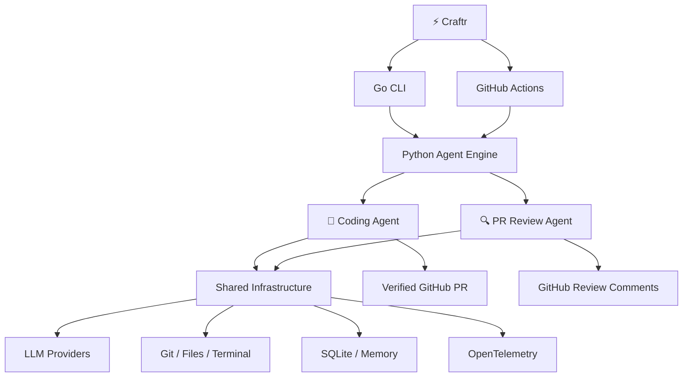

# ⚡ Craftr

### Autonomous AI Engineering

**Build. Test. Review. Ship.**

<p align="center">
  
  
  
  
</p>

**Craftr** is an open-source autonomous AI engineering system featuring an independent coding agent and an automated GitHub PR reviewer.

It doesn't just suggest code. It aims to understand repositories, implement changes, execute tests, investigate failures, and review incoming contributions.

---

## ✨ What can Craftr do?

<table>
<tr>
<td width="50%" valign="top">

### 🤖 Autonomous Coding

- Understand existing repositories.
- Plan and implement changes.
- Edit files and execute commands.
- Run tests and debug failures.
- Turn GitHub issues into pull requests.

</td>
<td width="50%" valign="top">

### 🔍 Automated Code Review

- Automatically inspect GitHub PRs.
- Understand changes in context.
- Detect potential software defects.
- Validate review findings.
- Publish actionable inline comments.

</td>
</tr>
</table>

## 🏗️ Architecture



## 🧰 Technology Stack

| Layer | Technologies |
|---|---|
| CLI | Go, Cobra, Bubble Tea |
| Agent Engine | Python, Pydantic AI |
| AI Infrastructure | LLM APIs, Tool Calling, MCP |
| Code Intelligence | AST, Tree-sitter, LSP |
| Storage | SQLite, Markdown |
| Execution | Git, Docker |
| GitHub | GitHub API, GitHub Actions |
| Evaluation | DeepEval, Custom Benchmarks |
| Observability | OpenTelemetry |

## 🚀 Getting Started

> Craftr is currently under development. Installation and usage instructions will be published with the first working release.

The intended CLI experience:

```bash
# Initialize Craftr
craftr init

# Give the coding agent a task
craftr run "Implement JWT authentication"

# Work on a GitHub issue
craftr issue 42

# Review a pull request
craftr review 128
```

## 🧠 Engineering Focus

Craftr isn't just about making agents generate code. It's about making them reliable.

- **Context Engineering** — Understand repositories and maintain useful context.
- **Agent Orchestration** — Manage tools, tasks, execution and specialized agents.
- **Verification** — Test implementations and investigate failures.
- **Evaluation** — Measure task success, review precision, recall and false positives.
- **Observability** — Inspect execution traces, metrics and failures.

<details>
<summary>📊 Evaluation Metrics</summary>

| Coding Agent | PR Reviewer |
|---|---|
| Task resolution rate | Precision |
| Test pass rate | Recall |
| Regression rate | F1 score |
| Tool-use accuracy | False-positive rate |
| Cost per task | Finding localization |

</details>

## 🗺️ Roadmap

- [ ] Core agent runtime and Go–Python communication
- [ ] Autonomous coding agent
- [ ] Repository exploration and context management
- [ ] GitHub issue-to-PR workflow
- [ ] Automated PR reviewer
- [ ] Agent evaluation benchmarks
- [ ] OpenTelemetry integration
- [ ] MCP support
- [ ] Docker-based execution isolation
- [ ] Stable CLI release

<details>
<summary>🔐 Design Philosophy</summary>

- Local-first architecture.
- Bring Your Own LLM API Key (BYOK).
- No mandatory hosted backend.
- Separate permissions for coding and reviewing.
- Evidence-based verification.
- Measurable agent reliability.

</details>

---

<p align="center">
  <b>⚡ Craftr</b><br/>
  <i>Autonomous AI Engineering</i><br/><br/>
  Build. Test. Review. Ship.
</p>

<p align="center">
  ⭐ Star the repository if you're interested in the project!
</p>
